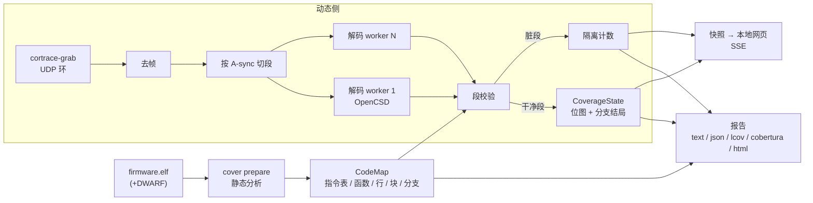

# Cortrace — 实时代码覆盖率（设计文档）

日期：2026-10-28
状态：P0 已验证，P1（离线覆盖引擎与 `cortrace cover`）已实现并上板验证，见 §13。P2（实时）未开始。
§5 到 §8 正文保留设计时的思路，实现和设计不一致的地方在各节以"实现"标出。

对标 SEGGER J-Trace PRO + Ozone 的 Live Code Coverage 和 Lauterbach TRACE32 的基于 trace 的代码覆盖率。
评估 cortrace 现有代码能直接复用多少、缺什么、怎么分阶段加。

> 关系：覆盖率直接吃 `00-architecture.md` 的解码层输出（`Element` 流），不动调用栈和 Perfetto 输出。
> 实时化依赖 `03-perfetto-record-bridge.md` §4 讨论过的"批改流"，本文给出覆盖率场景下更省事的做法，
> 因为覆盖是集合并集，丢一段数据只会少报，不会错报。

---

## 0. 结论

- **可行，而且数据已经在手。** ETM 指令流就是覆盖率的原始数据：每个 `InstrRange` 是一段连续执行过的指令。
  现在缺三块：静态侧的"分母"（ELF 里到底有哪些指令、哪些行、哪些分支）、覆盖状态容器与可信度模型、
  增量/并行的解码流水线。
- **推荐三步走**：P0 先验证 6 条假设（2 到 3 人天）；P1 离线覆盖引擎加报告，单独交付就等价于 Ozone 的
  Code Profile 报告（约 6 到 8 人天）；P2 做实时（滚动分段加并行解码加本地网页，约 8 到 10 人天）。
  估算是粗估，见 §10。
- **最大风险是实时性。** 今天实测整条解码流水线比数据到达慢 5.4 倍（§3.2）。覆盖率场景有两个缓解：
  关掉周期计数和时间戳后 ETM 数据量会降（待 P0 量化），而且数据可以按 A-sync 切段并行解码。
  追不上时丢段不会产生错误的"已覆盖"，实时性可以降级，不会失败（§6.3）。
- **范围要说清楚。** 这是开发期的洞察工具，不是认证证据：没有工具鉴定，数据链路没有 CRC（§5.4）。
  这和仓库 `AGENT.md` 的"判据要诚实"一致：报告里必须同时给出丢数据的次数和被隔离的字节数。

---

## 1. 目标与非目标

**目标**

- 指令覆盖、源码行覆盖（全覆盖/部分覆盖/未覆盖）、函数覆盖、调用覆盖、对象码分支覆盖（taken / not-taken）、
  基本块覆盖。
- 实时：目标跑着，覆盖率每秒更新，源码视图按行着色。
- 报告：文本（对齐 Ozone）、JSON、lcov、Cobertura、HTML；多次运行合并；与基线对比；CI 门限。
- 非侵入：不改固件，不插桩。

**非目标**

- 不做 MC/DC 和源码级决策/条件覆盖（TRACE32 能做，但需要编译器配合和决策映射，见 §2、§11）。
- 不做数据覆盖，不做多核（S32K344 的第二个核等第二块板子有数据再说）。
- 不做动态加载代码（运行时装入的模块没有 ELF 对应）。
- 不做 DO-178C / ISO 26262 工具鉴定，也不声称报告可以当认证证据。
- 不替换现有的"函数覆盖诊断"输出（`=== function coverage ===`），它回答的是另一个问题（§3.1）。

---

## 2. 业界做了什么

| | SEGGER J-Trace PRO + Ozone | Lauterbach TRACE32 | cortrace 现状 |
|---|---|---|---|
| 数据来源 | ETM 指令流，流式送到主机 | ETM 指令流；另有 incremental 与 SPY 两种覆盖模式（本文没有读到两者的细节） | ETM 指令流，批量抓取 |
| 实时 | 是，目标运行时在线更新，整套测试可以一次跑完不用停 | 摘要里没有明确说是否在线更新，未核实 | 否，抓完再解（§3.2） |
| 指标 | 文件、函数、源码行、指令；行有"全部/部分"着色；还能显示条件没有真假都出现过 | 对象码语句（每条汇编执行过）；源码级语句、分支、决策、条件、MC/DC、函数、调用 | 只有一个函数级诊断（§3.1） |
| 源码视图 | 行着色：绿全覆盖、橙部分覆盖；展开行看指令覆盖 | 有 | 无 |
| 报告 | 文本报告，可按全应用、模块或函数导出，字段含"源码行 N/M"和"指令 N/M" | JSON 导出，`t32covtool` 合并多次运行并出报告 | 无 |
| 质量背书 | 无公开的工具鉴定包（本文未查到） | 有 ISO 26262、DO-178C 等的工具鉴定套件 | 无 |

要点（均来自两家公开资料，见 §12，已改写为我们的表述）：

- 两家都先在对象码（指令）层累积执行信息，再映射到源码行。我们也走这条路。
- Ozone 的"条件没有真假都出现过"在对象码层就是**条件分支的 taken / not-taken 两种结局**，ETM 能直接给出，
  所以 P1 就能做对象码分支覆盖。
- TRACE32 的源码级决策、条件和 MC/DC 是在对象码轨迹之上做的；怎么把对象码映射回源码决策，
  本文没有读到官方细节，推测会依赖编译选项和优化等级。这一块不在本文范围（§1 非目标）。
- "合并多次运行"是刚需（t32covtool 存在的原因）：覆盖率几乎从来不是一次运行出来的。

### 2.1 PC 程序的覆盖率工具：能借什么

PC 上没有一个工具同时具备"硬件指令 trace、实时、源码行着色"，但各个环节都有成熟的参考。下表按对我们的
参考价值排序（描述已改写，出处见 §12）。

| 类别 | 工具 | 做法 | 我们借什么 | 借到哪里 |
|---|---|---|---|---|
| 硬件 trace | honggfuzz（Intel PT / BTS） | 用处理器 trace 做覆盖引导 fuzzing | Intel PT 之于 x86 就是 ETM 之于 Cortex-M，同一类数据源 | 定位 |
| 硬件 trace | PTrix（论文） | 指出从高度压缩的 PT 轨迹里重建覆盖很慢，反而拖慢 fuzzing；解法是让 trace 解析与目标执行高度并行，并直接用解码后的轨迹当反馈，省掉完整的覆盖重建 | 和我们的瓶颈完全同构（§3.2，慢 5.4 倍）。"并行解析"对应 §6.2 路径 B，"不做完整重建"对应路径 D | §6.2 |
| 二进制层 | kcov | 只靠 DWARF 调试信息、不用特殊编译选项收集 ELF 的覆盖，对长时间运行的程序持续输出结果 | "DWARF 行表即分母"的最小实现；持续刷新输出 | §5.2、§7.3 |
| 二进制层 | DynamoRIO drcov + Lighthouse（IDA、Binary Ninja）、Dragon Dance（Ghidra）、CutterDRcov、bncov | 运行时记录执行过的基本块，覆盖数据与模块映射分开存，在反汇编器里着色、合并、做集合运算 | 覆盖数据和 CodeMap 分开存；多次运行做并集、差集对比 | §7.1 `merge` / `diff` |
| 聚合与界面 | syzkaller + kcov（Linux 内核） | 内核 kcov 导出执行过的基本块地址，管理端用 objdump、nm、addr2line、readelf 映射到函数和行，网页上按目录树显示"X% of N" | 地址到行的映射流程；按目录树逐级汇总的网页 | §5.2、§7.3 |
| 聚合与界面 | vscode-syzkaller-coverage | VS Code 扩展，在编辑器里高亮一个正在运行的 syz-manager 已覆盖的行 | 编辑器内实时着色，正是 §7.3 想要的形态，数据源换成 ETM | §7.3 |
| 插桩，运行中可读 | LLVM source-based coverage 的 continuous 模式（`%c`） | 计数器在运行中就同步到文件，支持在线合并 | "映射建一次，计数器随时取快照"的数据模型 | §5.3 `snapshot()` |
| 插桩，运行中可读 | Go `-cover` + `GOCOVERDIR`、`runtime/coverage.WriteCountersDir` | 运行中的程序可随时把计数器写到目录；社区有用 HTTP handler 实时出报告的项目 | 快照接口与 HTTP 实时报告 | §7.3 |
| 插桩，运行中可读 | JaCoCo agent 的 `tcpserver` 模式 | 执行数据经 TCP 连接按需取出，被测程序不用停 | 拉取式快照，不需要停程序 | §7.3 |

我们没法插桩，所以第三类只借数据模型和接口形态，不借采集手段。

---

## 3. 现状盘点

### 3.1 已有什么，缺什么

| 能力 | 现状 | 位置 |
|---|---|---|
| 已执行的指令区间 | `Element` 的 `InstrRange` 带 `start_addr`、`end_addr`（不含）、`branch`、`last_executed`。**只在 `cov.observe` 和 `machine.process` 里用一下就丢，不存。** | `include/cortrace/element.hpp`，`tools/cortrace_decode.cpp:625` |
| OpenCSD 提供但适配层丢掉的字段 | `isa`、`last_instr_sz`、`last_instr_cond`、`num_instr_range`（Thumb 里不能用地址差推算指令数） | `third_party/opencsd/.../trc_gen_elem_types.h`，`src/opencsd_decoder.cpp:on_element` |
| 分支条件性 | `classify()` 把条件分支和无条件分支都归成 `BranchKind::Direct`，条件性丢了 | `src/opencsd_decoder.cpp:classify` |
| "函数覆盖" | 不是真覆盖率。只记每个区间**起点**所在函数的区间数，然后和"渲染成 slice 的函数"比对，找出"有指令流但没有 slice"的函数，用来诊断丢调用 | `tools/cortrace_decode.cpp:58 struct Coverage`，报告在 `:819` 附近 |
| 符号 | `SymbolTable` 只有 `{addr, name}`，**没有函数大小**；`ElfInfo`（Python）有 `symbol_size()` | `src/symbols.cpp`，`python/cortrace/elfinfo.py` |
| 行号表 | **没有**。全仓库没有 `.debug_line` 读取，也没有反汇编 | grep 确认 |
| ELF | C++ 只会读 ELF32-LE 的 PT_LOAD（按 p_paddr）；Python 用 pyelftools（已是依赖） | `src/opencsd_decoder.cpp`，`python/cortrace/elfinfo.py` |
| 流式 | 无。`cortrace serve` 点 Start 后也是批量抓取加批量解码 | `python/cortrace/serve.py` |
| 数据丢失标记 | 有：`NoSync`、`AddrNacc`、`TraceOn`，以及报告里的 `stream health` | `Coverage::observe` |

好消息：`IDecoder::process()` 本来就能分块反复调用，`CallStackMachine` 本来就逐元素消费，覆盖引擎可以
做成和它并列的另一个 `ElementSink`，不动现有逻辑。

### 3.2 实测：解码比实时慢

2026-10-28，H743 跑 CoreMark（-O0，CPU 150 MHz，TRACECLK 56.25 MHz，4 位口，TRCCONFIGR=0x810 即
CCI+TS），`cortrace capture --secs 3` 的原始文件，用已安装的 `cortrace-decode --raw` 全量解码
（不写 Perfetto）：

| 项 | 数值 |
|---|---|
| 原始抓取 | 168,753,152 B（3 s，56.25 MB/s） |
| 去帧后 ETM 数据 | 60,404,973 B（原始的 35.8%，约 20.1 MB/s） |
| 解码墙钟时间 | 16.33 s（用户态 15.36 s，单线程） |
| 峰值内存 | 969,636 KB（整个原始文件读进内存） |
| 调用/返回 | 2,254,452 / 2,254,452，平衡 |
| 周期计数元素 | 17,177,857 |
| A-sync 数 | 58,894（平均每约 1 KB ETM 一个） |

折算：解码吞吐约 10.3 MB/s 原始、3.7 MB/s ETM，**比到达速度慢 5.4 倍**（16.33 s 处理 3 s 的数据）。

**P0 补测（同日，A4/A5）**：用一个只挂空 sink 的小程序（`tmp/bench/ocsd_bench.cpp`，不跑去帧、调用栈机）
单独测 OpenCSD；再在运行中的板子上用 OpenOCD 把 `TRCCONFIGR` 从 `0x811`（CCI+TS）改成 `0x1`，抓 2 s 对比。

| | CCI + TS 开（`0x811`） | CCI + TS 关（`0x1`） |
|---|---|---|
| ETM 数据率 | 约 20.1 MB/s | 约 5.0 MB/s（降到 1/4） |
| 每秒指令区间 | 约 11.6 M | 约 10.3 M |
| OpenCSD 单独解码 | 13.57 s / 3 s 数据，**4.5 倍于实时** | 7.29 s / 2 s 数据，**3.6 倍于实时** |
| 其中 OpenCSD 占整条流水线 | 83%（13.57 / 16.33 s） | — |

结论：

- 慢的是 OpenCSD 本身，去帧和调用栈机加起来只占 17%。
- **OpenCSD 的开销跟着执行的指令走，不跟着 ETM 字节走**：关掉 CCI/TS 字节少了 3/4，解码时间只少约 20%。
  折算每个区间约 0.35 到 0.4 µs，约每条指令 36 ns，主要花在逐条跟随指令和读内存镜像上。
- 所以覆盖率档位（§5.6）的价值是**降带宽、降 FIFO 溢出**，不是加速解码；实时化仍然需要约 4 到 5 倍的并行，
  或者 §6.2 路径 D 那种查表跟随。
- 这是最坏情形：`-O0` 的 CoreMark 分支密度极高。

---

## 4. ETM 能给什么，不能给什么

| 问题 | 答案 | 依据 |
|---|---|---|
| 哪些指令被取指执行过 | 能，精确。区间内的每条指令都执行过 | `InstrRange` |
| 条件分支走没走 | 能。区间在分支处结束，`last_instr_exec` 表示这次是否 taken | 待 P0 假设 A1 验证 |
| 间接分支的目标 | 能，来自地址包 | OpenCSD |
| IT 块里被条件抑制的非分支指令 | **不能**。它们落在区间里，被算作"执行过"，实际是空操作 | ETMv4 M 类不对非分支指令逐条出条件结果 |
| 中断打断 | 能，有 `Exception` 元素；返回后继续累计 | OpenCSD |
| 数据丢失（FIFO 溢出、位错误） | 能**发现**，不能**补**：解码器丢失同步，之后在下一个 A-sync 重新对齐 | `NoSync`、`AddrNacc` |

所以覆盖率的语义必须是 **"在可信数据里观测到执行过"**，不是"没执行过"。丢数据的地方是"未知"。
报告里必须区分：

- `covered`：在可信分段里观测到。
- `not observed`：没观测到。会话无丢失时，这就是未覆盖；有丢失时，只能说"没观测到"。

---

## 5. 设计

### 5.1 总览



核心思路：**静态侧一次性建好 CodeMap，动态侧只往位图里置位。** 置位很便宜，贵的是 OpenCSD 解码，所以并行化
和丢段策略都围绕解码做。

### 5.2 静态侧：CodeMap

从 ELF 一次性建出，缓存成文件（按 ELF 的 build-id 或 SHA-256 命名，ELF 变了就重建）。

| 内容 | 来源 | 说明 |
|---|---|---|
| 可执行区间 | PT_LOAD 且带 X 标志的段 | 注意 C++ 现有解析按 p_paddr（LMA），覆盖率用的是运行地址，两者对 `.text` 通常相同；放在 RAM 里执行的代码（ramfunc）需要 VMA，见 §11 |
| 指令边界与类型 | 对每个可执行段做线性扫描，用 ELF 里的映射符号 `$t` / `$a` / `$d` 切分代码和数据 | 实测 `H743_Blink.elf` 有 370 个 `$t`、335 个 `$d`，说明 .text 里确实夹着字面量池，不能整段当指令解 |
| 单条指令解码 | OpenCSD 自带的 `TrcIDecode`（`decoder/include/i_dec/trc_i_decode.h`，输入 `ocsd_instr_info`，输出大小、类型、是否条件、是否链接、直接分支目标） | 不引入 capstone，复用现有依赖，也和解码器看到的是同一套指令语义 |
| 函数 | `.symtab` 的 `STT_FUNC`，地址清 Thumb 位，带 `st_size` | 实测 501 个 FUNC 符号 |
| 行表 | DWARF `.debug_line`，保留 `is_stmt` | 现有固件是 `-gdwarf-2`，实测有约 24k 行记录；pyelftools 支持 |
| 基本块 | 指令表里的分支目标和分支之后的指令是块首 | 块覆盖用 |
| 分支点 | 条件直接分支（`B<cond>`、`CBZ`、`CBNZ`）；记录每个的 taken / not-taken 位 | `TBB`/`TBH` 是间接表分支，不算 |

**怎么实现的取舍**

| 方案 | 优点 | 缺点 | 取舍 |
|---|---|---|---|
| A. 全在 C++ 里做，含自写 `.debug_line` 读取 | 单个二进制，没有 Python 依赖 | DWARF 2 到 5 的行表状态机约 400 行，要写测试 | 备选 |
| B. Python 用 pyelftools 读行表和函数大小，输出 `lines.tsv`；C++ 做指令扫描并合成 CodeMap | 行表不用自己写；pyelftools 已在包依赖里 | 两段流程，多一个中间文件 | **推荐 P1** |
| C. 全在 Python 里做，capstone 反汇编 | 最简单 | 新增依赖，指令语义和 OpenCSD 可能不一致 | 不选 |

**实现**：走的是 B 的变体，但顺序反过来，没有中间文件。C++ 的 `CodeMap::from_elf`（`src/codemap.cpp`）
按带 `SHF_EXECINSTR` 的节和 `$t` / `$a` / `$d` 映射符号切出 Thumb 代码（没有映射符号时退回 `STT_FUNC`），
用 `TrcIDecode` 逐条扫出指令表，每次运行现建，不缓存（28k 条指令的固件建图耗时可忽略）。
异常向量表从 `.isr_vector` 等节或 `g_pfnVectors` 等符号读出，用于异常入口校验（§5.4）。
解码结束后 C++ 输出对象级覆盖，Python（`covmodel.attach_source`）再用 pyelftools 读 DWARF 行表和 `.symtab`，
把行号和函数挂到每条指令上，写成自包含的覆盖文件。基本块没有做。

内存规模：Flash 2 MB 时按半字对齐是 1M 个单元，指令起点位图 128 KB，执行位图 128 KB，分支结局表每个条件分支 2 位。
全部可放进内存，不需要稀疏结构。

### 5.3 动态侧：CoverageSink

新模块 `include/cortrace/coverage.hpp` 加 `src/coverage.cpp`，进 `cortrace_core`，**不要写在 `tools/cortrace_decode.cpp`
里**：tools 下的代码不在 C++ 单测和 95% 覆盖率门里，现有 `struct Coverage` 就是因此没有测试。
接口和 `CallStackMachine` 对称：

```cpp
class CoverageSink {
public:
    explicit CoverageSink(const CodeMap&);
    void on_element(const Element&);   // 逐元素
    void commit_segment();             // 干净段：把本段增量并入全局
    void discard_segment();            // 脏段：丢弃本段增量，计入隔离
    CoverageSnapshot snapshot() const; // 只读快照，供报告和网页
};
```

处理规则：

- `InstrRange [st, en)`：把半字位图 `[st/2, en/2)` 置位（本段临时位图）。
  `last_instr_cond` 且分支类型为直接分支时，在分支点表里置 taken 或 not-taken 位。
  分支指令地址 = `en - last_instr_sz`。
- 调用（`is_call()`）：记录 `(调用点, 目标)` 边，用于调用覆盖。
- `Exception` / `ExceptionRet`：不置位，只作为段内上下文。
- `NoSync` / `AddrNacc` / `TraceOn` / `Overflow`：本段标脏。
- 区间落在 CodeMap 可执行区间之外：本段标脏，并计入"区间越界"计数。这是对数据损坏的一道廉价检查。

`Element` 需要补字段：`isa`、`last_instr_sz`、`last_instr_cond`、`num_instr_range`。只改 `element.hpp` 和
`opencsd_decoder.cpp::on_element`，`IDecoder`、`ElementSink` 签名不变，现有的 `CallStackMachine` 单测不受影响
（新字段给默认值）。

可选 `--count`：每个指令起点一个 `uint32_t` 命中数，用于热点分析和"确认覆盖"（§5.4）。2 MB Flash 最坏 4 MB。

**实现**：`CoverageSink(map, lag)`。接口按实际的数据流调整：

- `add_segment_start(offset)`：`cortrace-decode` 在把每块 ETM 字节交给 OpenCSD 之前，先用 `AsyncScanner`
  找出其中的 A-sync（11 个 `0x00` 加 `0x80`），按字节偏移告诉 sink 新段从哪里开始。
- `on_element(e)`：逐元素处理，命中先记在当前段里。
- `finish(total)`：收尾，把还在等待的段提交或隔离。
- 每条指令都有 `uint32_t` 命中数和"在几个不同段里被看到"的段数（后者给 `--confirm`）；条件分支另有
  taken / not-taken 的次数和段数；间接分支记录观测到的目标集合。计数始终开着，没有单独的 `--count`。
- `Element` 实际补的字段是 `last_instr_sz`、`last_instr_cond`、`num_instr`、`has_return_addr`、`return_addr`
  （后两个来自 OpenCSD 异常包的返回地址，用于异常返回校验）。`isa` 没有加：M 类只有 Thumb。

### 5.4 完整性：怎么避免"错报已覆盖"

覆盖率里最危险的错误是**错报已覆盖**，漏报只是让你多写一个测试。数据链路（FPGA 采样、TPIU 帧）没有 CRC，
位错误会进来。仓库里的历史教训（`00-architecture.md` §1）就是别的解码器带着过期 PC 往下走，
编造出 4.6 倍的指令数。设计上设三道防线：

1. **按 A-sync 分段，两阶段提交。** 一个段是相邻两个 A-sync 之间的字节（本负载下平均约 1 KB ETM）。
   每个 worker 先把本段结果记在**段内临时位图**，段内没有 `NoSync` / `AddrNacc` / `Overflow` / 越界区间才并入全局，
   否则整段丢弃并计入"隔离字节数"。A-sync 之后解码器重新对齐，所以脏段不会污染相邻段。
2. **静态交叉校验。** 区间最后一条指令在 CodeMap 里必须是分支点，且类型和 OpenCSD 报告的 `BranchKind` 一致；
   条件性一致；直接分支的 taken 目标等于静态目标。不满足就标脏。
3. **可选"确认覆盖"。** `--confirm 2`：一条指令至少要在两个不同的段里被观测到才算 `covered`。
   单个比特翻转只可能影响一个段，所以单次事件造不出确认覆盖。代价是低频路径需要至少出现两次。

**残余风险**：一个翻转后仍然合法、并且通过 2 的包，会产生一个看起来合理但错误的区间。第三道防线把它压低，
但不是零。报告里据此写明：

```
trace loss : 3 sync losses, 1 address-nacc, 0 overflow
quarantined: 4 segments, 4,123 bytes (0.007%)
mode       : confirm=2
```

**实现**（`src/coverage.cpp`）。子集测试（§9）表明只有上面三道防线不够：一个坏字节常常让 OpenCSD
沿着一条"合理"的错路走好几个段才失步，A-sync 之后的段也就跟着被污染。实际做法是：

1. **段提交带延迟。** 段在 A-sync 处结束后不马上提交，先排队，再等 `--cov-lag N`（默认 8）个段。
   这期间任何丢失（`NoSync`、`AddrNacc`、段内 `TraceOn`、`Overflow`）或任何一项静态校验失败，
   都把当前段**和所有还在排队的段**一起隔离，并清空影子调用栈与异常栈。流的最后一段没有后继来证明它
   在哪里结束，有多个段时也隔离。
2. **静态交叉校验**，每个 `InstrRange` 都做：
   - 区间的起止都落在 CodeMap 的指令边界上，且在同一段连续代码里（`outside_code`）；
   - OpenCSD 报告的指令数等于静态数出的条数（`count_mismatch`）；
   - 末条指令的分支类型和条件性与静态解码一致（`kind_mismatch`、`cond_mismatch`）；
   - **流向**（`flow_mismatch`）：下一个区间的起点必须是上一个区间允许的去处，即不跳转时的下一条、
     直接分支的静态目标、异常向量表里的入口，或 ISB 之后的下一条；
   - **影子调用栈**（`return_mismatch`）：调用时压入返回地址，返回时比对。异常进入时压一个标记，
     返回弹到标记就是 EXC_RETURN，不做比对；没有已知调用者时只要求返回到某个调用指令之后。
     异常返回到不是被打断的地方计为 `exception_return_elsewhere`（多半是 RTOS 切线程），不算失败。
   - 周期性 A-sync 不打断流向和调用栈校验，只有丢失才重置。
3. **确认覆盖**：每条指令和每个分支结局记录"在几个不同的段里出现过"，`--confirm N` 只认 N 个段以上的。

在 `etm_cc6.bin`（6 MB 干净 ETM，CoreMark）上随机改字节（70% 单比特翻转，30% 删掉 1 到 63 字节），
`--cov-lag 8`，每档 2 到 6 次试验，和无损解码的覆盖比较：

| 每 6 MB 坏几处 | 结果 |
|---|---|
| 1 到 5 | 8 次试验全部是无损覆盖的子集，没有任何多报 |
| 50 | 6 次里 4 次多报了分支结局（1 到 5 个），其中 1 次还多报了 56 条指令；`--confirm 2` 时指令零多报，分支结局最多 1 个 |
| 500 | 6 次全部多报（最多 90 条指令）；`--confirm 2` 时最多 1 条指令、2 个分支结局 |

延迟的取舍（同一组试验）：`lag 1` 在 50 处坏点时也会多报指令，`lag 16`、`lag 32` 多报只少一点，
但隔离的段成倍增加（500 处坏点时 `lag 32` 隔离了 85% 的段）。所以默认 8。

**不能靠静态校验发现的情况**：条件分支的原子位翻转，而两条路在后面又汇合（`if` 没有 `else`、循环的最后一次）。
两条路都合法，指令数、流向都对得上，只有分支结局和其中一段指令是错的。这就是上表 50 处坏点时剩下的多报。
`--confirm 2` 能把它压到接近零，代价是只执行过一次的路径不再算覆盖。

真实链路的误码远低于上表：今天 75 MHz 的干净抓取（§13）两次共 50k 个段，丢失和校验失败都是 0。
有误码的链路上，丢失会先暴露出来（报告里 `lossy`），这时再用 `--confirm 2`。

### 5.5 指标定义

| 指标 | 分子 | 分母 | 备注 |
|---|---|---|---|
| 指令覆盖 | 被观测到的指令数 | CodeMap 指令数 | 即 TRACE32 的对象码语句覆盖、Ozone 的 Instructions 列 |
| 源码行覆盖 | 全覆盖的行 | 有 `is_stmt` 行记录的行 | 行 = (文件, 行号)。同一行的所有指令（含内联展开的多份）都执行才算"全覆盖"；执行了一部分算"部分覆盖" |
| 函数覆盖 | 入口指令被执行的函数 | `STT_FUNC` 数 | 另外给"被触及"（函数内任意指令被执行）用来发现只从中途进入的情况，例如尾调用或 ISR 入口 |
| 调用覆盖 | 被执行的调用点 | CodeMap 里的直接调用点；间接调用另列"观测到的目标集合" | |
| 分支覆盖（对象码） | taken 和 not-taken 都出现过的条件分支 | 条件直接分支数 | 对应 Ozone 的"条件真假都出现过" |
| 基本块覆盖 | 块首被执行的块 | 块数 | |

**实现**（`covreport.py` 开头写了同样的规则，所有格式共用）：

| 指标 | 算覆盖的条件 | 说明 |
|---|---|---|
| Instructions | 指令被看到过（`--confirm N` 时要在 N 个段里） | 分母是 CodeMap 的全部 Thumb 指令 |
| Source Lines | 这一行**至少一条**指令被看到 | 和 lcov 的 `DA > 0`、gcov 一致；JSON 里另给 `covered` / `partial` / `uncovered` / `not_observed` |
| Branches | 一个**结局**（taken 或 not-taken）被看到 | 每个条件分支算 2 个，和 lcov `BRDA`、gcc 的分支计数一致 |
| Functions | 函数里任意一条指令被看到 | lcov 的 `FNDA` 用入口指令的命中数 |

函数的指令按地址范围归属（内联进来的头文件代码算在调用它的函数和它所在的 `.c` 文件下），
行按 DWARF 行表归属（内联代码的行算在头文件里）。会话有丢失或校验失败时，没看到的行是 `not_observed`，不是 `uncovered`。
基本块覆盖和调用覆盖没有做；间接分支的目标集合记在覆盖文件里，报告暂不展示。

排除机制：`--include` / `--exclude`（按文件或函数的 glob；实现只按源文件的绝对路径匹配，例如 `'*/Drivers/*'`）。启动代码、HAL、第三方库默认可以排除，
类似 Ozone 允许"全应用、选定模块、选定函数"出报告。

内联和优化：`-O0` / `-Og` 时行覆盖语义最清楚；`-O2` 时同一行会分布在多个函数里，所以行报告同时给出按函数的拆分，
避免"一个实例没走到就把整行判成部分覆盖"却看不出是谁。

### 5.6 ETM 配置：覆盖率档位

`trace_arm.arm_etm` 目前固定写 `TRCCONFIGR=0x810`（CCI + TS）、`TRCVICTLR=0x201`（全部追踪）。
覆盖率不需要周期计数和时间戳，建议加一个档位：

| 寄存器 | 现在 | 覆盖率档位 | 目的 |
|---|---|---|---|
| `TRCCONFIGR` | `0x810` | `0x000`（CCI、TS 都关；分支广播保持关） | 降 ETM 带宽，降 FIFO 溢出概率，降解码量 |
| `TRCVICTLR` | `0x201`（全部） | 可选地址范围过滤，只追被测模块 | 进一步降带宽 |
| `TRCSYNCPR` | `0xC` | 保持 | 同步点密，利于分段并行与丢失后快速恢复 |

用法：`cortrace arm --profile coverage`。**带宽下降多少没有测过**，是 P0 的第五条假设。

**实现**：`cortrace arm --profile coverage` 写 `TRCCONFIGR=0x1`，默认 `--profile timing` 仍是 `0x810`。
实测带宽降到约 1/4（§3.2）。地址范围过滤没有做。Perfetto 的时间基需要 timing 档位。

---

## 6. 实时化

### 6.1 为什么这是难点

覆盖状态的更新极便宜（位图置位），难点全在上游：

- 解码比到达慢 5.4 倍（§3.2）。
- 现有流水线是批：整个文件读进内存、去帧、一次喂给 OpenCSD（`cortrace_decode.cpp` 约 750 行处）。
- 去帧是整块处理：相位搜索加 TPIU 解帧用整个 buffer，`docs/03` §4 说"天然可增量"，但代码不是这样写的，
  需要保留跨块的半帧和半字节相位。

### 6.2 三条路

| 路径 | 做法 | 延迟 | 改动量 | 风险 |
|---|---|---|---|---|
| A. 滚动分段 | `cortrace-grab` 每 N 秒落一个文件，每个文件独立跑 `cortrace-decode --cov-out`，合并 | 约一个分段的解码时间 | 小 | 追不上时积压 |
| B. 并行解码 | 在 A-sync 边界把去帧后的 ETM 切成段，worker 池并行解码，各自产出增量位图 | 秒级 | 中 | 切段正确性（A6） |
| C. 常驻流式程序 | 新的 `cortrace-cov`，从 UDP 环直接读，增量去帧，worker 池，快照服务 | 秒级，连续 | 大 | 要重写入口和背压 |
| D. 用静态 CFG 引导的快速跟随器 | 只让 OpenCSD 做**包级**解码，指令流跟随自己查 CodeMap 做 | 实时（单核可能够） | 大，且要差分验证 | 重写了 OpenCSD 最复杂的部分 |

**推荐顺序**：P1 先做离线（A 的单文件版），P2 做 B 加最薄的常驻编排（Python 里管 worker 池），
C 和 D 作为 P3 的可选项，D 仅在 P2 实测仍追不上时才做，并且必须用完整 OpenCSD 解码当参照做差分测试
（仓库不重蹈"精简解码器编造流"的覆辙）。

PC 上的先例（§2.1）支持这个顺序：PTrix 遇到的就是"处理器 trace 解析跟不上"，它的两条解法，
并行解析和不做完整重建，分别对应路径 B 和 D。PTrix 的场景（x86 fuzzing，要的是边覆盖反馈）
可以接受近似；我们要的是不错报的覆盖，所以路径 D 的差分验证是硬要求，不能省。

### 6.3 追不上怎么办：覆盖是集合并集

时间线需要每个事件，覆盖率只需要"出现过"。所以：

- 丢掉一个段，**只会少报，不会错报**。
- 被动丢段会使低频路径可能错过，所以要显式记账：报告和网页顶栏写"跳过 K 段（x%）"，状态显示 `degraded`。
- 优先保证：先到先解、新数据不覆盖旧数据；队列满时丢**最旧的未处理段**还是**最新的**，取决于是否需要追赶，默认丢最新，保证已排队的段完整。
- 可选 `--keep-raw N`：把原始数据落到一个有上限的环形文件，会话结束后补解（catch-up），把 `degraded` 变回 `complete`。

这个性质让实时模式可以放心降级：最坏情况是"报告说 not observed 但其实执行过"，不会反过来。

### 6.4 并行切段的正确性

ETMv4 的 A-sync 之后紧跟 Trace Info、上下文和地址包，解码器可以从这里重新开始，不依赖之前的状态
（我们没开返回栈和分支广播）。所以相邻 A-sync 之间的字节可以独立解码，各 worker 持有自己的
`ocsd_dcd_tree`，共享只读的内存镜像。

要验证（A6）：串行解码与并行解码得到的覆盖并集完全相同。边界处需要特别的测试，包括 A-sync 图样恰好跨去帧块边界的情况。
内存镜像要在多个 tree 之间共享：`add_elf` 目前每个 tree 都会读一遍，N 个 worker 要避免 N 份拷贝（实测整条流水线峰值内存约 970 MB）。

### 6.5 吞吐账

| 量 | 值 | 来源 |
|---|---|---|
| 到达，4 位口、56.25 MHz | 56.25 MB/s 原始，约 20 MB/s ETM（周期计数和时间戳开） | 实测 §3.2 |
| 单线程整条流水线 | 约 3.7 MB/s ETM | 实测 §3.2 |
| OpenCSD 单线程 | 4.5 倍于实时（CCI+TS 开）/ 3.6 倍（关） | 实测 §3.2 |
| 需要的并行度（粗算） | 覆盖率档位下约 4 到 5，实际取 8 以上留余量 | 推算 |
| 本机核数 | 24 | `nproc` |
| 覆盖率档位后的 ETM 带宽 | 约 5 MB/s，降到 1/4 | 实测 §3.2 |

---

## 7. 输出与集成

### 7.1 命令行

```
cortrace cover prepare --elf fw.elf [--src-root DIR]      建 CodeMap 缓存
cortrace cover run     --elf fw.elf --iface eth0 --secs 5 -o out/   抓、解、出报告
cortrace cover live    --elf fw.elf --iface eth0 --open   实时，打开本地网页
cortrace cover report  out/cov.json --format lcov         换格式
cortrace cover merge   a.json b.json -o all.json          合并多次运行
cortrace cover diff    base.json new.json                 与基线对比
```

公共选项：`--include/--exclude`、`--confirm N`、`--count`、`--fail-under lines=80,branches=60`（用于 CI，
低于门限退出码非零）、`--require-lossless`（有任何丢数据就退出非零）。
C++ 入口：`cortrace-decode --cov-out cov.bin --cov-map fw.covmap`，`capture.py` 和 `test_decode_contract.py`
要同步（现有契约测试会检查 Python 传的每个参数 `cortrace-decode --help` 里都有）。

**实现**（P1）：

```
cortrace cover run    --elf fw.elf --iface eth0 --secs 2 --out-dir out/   抓、解、写 cov_<tag>.json、出报告
cortrace cover run    --elf fw.elf --raw-in raw.bin --out-dir out/        用现成的原始抓取
cortrace cover run    --elf fw.elf --etm-in etm.bin --out-dir out/        用 --dump-etm 的纯 ETM 字节
cortrace cover report out/cov_a.json --format lcov -o cov.info             换格式
cortrace cover merge  a.json b.json -o all.json                            合并同一 ELF 的多次运行
cortrace cover diff   base.json new.json [--fail-on-regression]            按源码行和函数对比
```

- `run` 和 `report` 的公共选项：`--format text|json|lcov|cobertura`、`-o`、`--confirm N`、`--include/--exclude GLOB`、
  `--src-root DIR`、`--no-functions`、`--fail-under lines=,insns=,branches=,functions=`、`--require-lossless`。
  `run` 另有 `--cov-lag N`（传给解码器）。退出码：0 正常，1 门限或无损要求没过，2 用法或输入错误。
- `run` 抓取时容忍 UDP 丢帧（`cortrace-grab` 返回 1 但文件已写），受损的段由解码器隔离；`cortrace capture` 仍然把丢帧当错误。
- `merge` 要求 ELF 的 sha256 相同，并拒绝同一次运行出现两次（否则计数翻倍，会骗过 `--confirm`）。
- `diff` 可以跨 ELF：按 (源文件, 行号) 和 (源文件, 函数名) 比较。
- C++ 入口是 `cortrace-decode --elf fw.elf --cov-out objcov.json [--cov-lag N]`，没有 `--cov-map`（CodeMap 每次现建）。
- `prepare` 和 `live` 属于 P2，没有做。

### 7.2 报告格式

| 格式 | 用途 | 说明 |
|---|---|---|
| text | 人看，对齐 Ozone 的 Code Profile 报告 | 见下方示例 |
| JSON | 机器、合并、基线 | 版本号、ELF 指纹、会话健康、总计、按文件的行/函数/分支 |
| lcov `.info` | `genhtml`、VS Code Coverage Gutters、各类覆盖率服务 | 含 `DA`、`FN`/`FNDA`、`BRDA` |
| Cobertura XML | CI 平台 | |
| HTML | 单文件离线浏览 | |

文本报告示例（**格式示意，数字不是实测**）：

```
Cortrace Code Coverage Report
ELF: fw.elf  sha256: 3f1c...  captured: 2026-10-28 18:44  duration: 5.0 s
Trace health: 0 sync losses, 0 quarantined segments, mode=confirm1  -> complete

Module/Function   |  Source Lines        |  Instructions        |  Branches
------------------+----------------------+----------------------+------------------
main.c            |                      |                      |
  main            |   10 / 11   90.9%    |   44 / 45   97.8%    |   3 / 4   75.0%
  led_toggle      |    3 /  3  100.0%    |    9 /  9  100.0%    |   0 / 0
------------------+----------------------+----------------------+------------------
  Total           |   47 / 52   90.4%    |  293 / 300  97.7%    |  11 / 14  78.6%
```

JSON 里按行给状态：`covered` / `partial` / `uncovered` / `not_observed`，并带 `insn: [已覆盖, 总数]` 和
`br: [已覆盖, 总数]`。

**实现**：HTML 没有做，lcov 交给 `genhtml` 即可（`genhtml --branch-coverage`；找不到源文件的库代码先用
`--exclude` 去掉）。有两种 JSON，不要混淆：

| 文件 | 写的人 | 内容 |
|---|---|---|
| `objcov`（`cortrace-objcov` v1） | `cortrace-decode --cov-out` | 只有地址：`insns: [addr, size, flags, hits, segs]`（flags = 分支类型 \| 条件 << 3 \| 分支点 << 4）、`branches: [addr, taken, not_taken, taken_segs, not_taken_segs]`、`indirect`、`health`、`commit_lag`。`cover run` 用完即删 |
| 覆盖文件 `cov_<tag>.json`（`cortrace-cov` v1） | `cover run` / `cover merge` | objcov 的内容加上每条指令的 (文件, 行)、函数表 `[name, lo, hi, file, line]`、ELF 路径和 sha256、每次运行的 `runs` 记录。自包含，`report` / `merge` / `diff` 不再读 ELF |
| 报告 JSON（`cortrace-cov-report` v1） | `report --format json` | 总计、按文件、按函数、按行，见上 |

文本报告默认把所有源文件的公共目录作为 `Sources:` 打印一次，表里只写相对路径。

### 7.3 实时界面（P2）

`cortrace cover live` 起一个只绑 `127.0.0.1` 的本地 HTTP 服务，一个静态页面加 SSE：

- 左侧文件树，每个文件带覆盖率；中间源码，行号槽着色（绿全覆盖、橙部分、红未覆盖、灰未观测）；右侧函数表可排序。
- 顶栏常驻健康状态：`complete` / `degraded` / `lossy`，丢段数，隔离字节数，最近更新时间，当前吞吐。
- 接口：`/api/snapshot.json`、`/events`（SSE，推送增量）、`/api/source?file=`。

安全：沿用 `wsrelay.py` 的做法，只绑回环地址并校验浏览器的 `Origin`；在此之上新增一个随机 token（放在 URL 里），
避免本机其他网页或进程直接读到源码和覆盖数据。`/api/source` 只返回 CodeMap 里记录过的源文件，并且 realpath 必须在 `--src-root` 白名单之内，禁止 `..` 越界读取。

在没有自带界面之前，P1 的 lcov 输出已经可以直接在 VS Code / Kiro 的 Coverage Gutters 里看到行着色，
是最便宜的"源码视图"。

形态上的参考（§2.1）：

- 目录树逐级显示"X% of N"，照 syzkaller 的覆盖页。
- 编辑器内实时着色，照 vscode-syzkaller-coverage：P2 先让 `cover live` 每次快照都重写一份 lcov 文件，
  Coverage Gutters 的文件监视会自动刷新，编辑器里就有了实时着色；自带网页可以晚一步。
- 拉取式快照（`/api/snapshot.json`），照 JaCoCo `tcpserver` 和 Go `WriteCountersDir`：取快照不打断采集和解码。

可选：把"覆盖率随时间增长"作为一条计数器轨道写进 Perfetto，在同一时间线上看测试什么时候触发了新路径。

---

## 8. 对现有代码的改动

| 位置 | 改动 | 说明 |
|---|---|---|
| `include/cortrace/element.hpp` | 增加 `isa`、`last_instr_sz`、`last_instr_cond`、`num_instr_range` | 给默认值，旧测试不受影响 |
| `src/opencsd_decoder.cpp` | `on_element` 填新字段；`classify()` 保留条件性 | |
| `include/cortrace/codemap.hpp`、`src/codemap.cpp`（新） | 建图、读写缓存文件 | 用 OpenCSD 的 `TrcIDecode` |
| `include/cortrace/coverage.hpp`、`src/coverage.cpp`（新） | `CoverageSink`、位图、分支表、段提交 | 进 `cortrace_core`，被单测覆盖 |
| `tools/cortrace_decode.cpp` | 新选项 `--cov-map`、`--cov-out`；把 `CoverageSink` 挂在 sink 旁边 | 现有 `struct Coverage` 保留，不改行为 |
| `python/cortrace/covmap.py`（新） | pyelftools 读行表和函数大小，输出 `lines.tsv` | |
| `python/cortrace/cover.py`（新） | 子命令编排、worker 池、合并、报告格式 | |
| `python/cortrace/trace_arm.py` | `arm_etm` 加覆盖率档位 | 老档位默认不变 |
| `python/cortrace/cli.py`、`capture.py` | 注册 `cover`；`decode_hw` 传新参数 | |
| `python/tests/test_decode_contract.py` | 把新参数加入契约 | |
| `docs/04-user-guide.md` | 加覆盖率章节 | 功能上线时再改 |

CMake 对 `src/`、`tools/`、`tests/` 用的是 glob，新文件会被自动收进来。

**实现（P1 实际改动）**：

| 位置 | 改动 |
|---|---|
| `include/cortrace/element.hpp` | `last_instr_sz`、`last_instr_cond`、`num_instr`、`has_return_addr`、`return_addr` |
| `src/opencsd_decoder.cpp` | 填新字段；`make_opencsd_insn_decoder()`（`TrcIDecode`，配置和 OpenCSD 的 ETMv4 解码器一致） |
| `include/cortrace/codemap.hpp`、`src/codemap.cpp`（新） | `CodeMap::from_elf`、`scan_region`、`index_at`、向量表 |
| `include/cortrace/coverage.hpp`、`src/coverage.cpp`（新） | `AsyncScanner`、`CoverageSink`、`CoverageHealth`、objcov 输出 |
| `tools/cortrace_decode.cpp` | `--cov-out`、`--cov-lag`；每块 ETM 先扫 A-sync 再交给 OpenCSD；打印覆盖小结 |
| `python/cortrace/covmodel.py`（新） | DWARF 行表、函数表、覆盖文件读写、合并、按行/函数/文件汇总 |
| `python/cortrace/covreport.py`（新） | text / JSON / lcov / Cobertura |
| `python/cortrace/cover.py`（新） | `cortrace cover run/report/merge/diff` |
| `python/cortrace/capture.py` | `grab(..., allow_loss=True)` |
| `python/cortrace/trace_arm.py`、`armctl.py` | `--profile timing` / `--profile coverage` |
| `python/cortrace/cli.py` | 注册 `cover` |
| 测试 | `tests/test_codemap.cpp`、`tests/test_coverage.cpp`、`python/tests/test_cover.py`，契约测试加 `--cov-out` / `--cov-lag` |
| `docs/04-user-guide.md` | 覆盖率一节 |

---

## 9. 验证设计

| 层 | 内容 |
|---|---|
| C++ 单测 | 用合成 `Element` 流喂 `CoverageSink`：区间置位的边界（Thumb 半字、跨函数区间）、条件分支 taken / not-taken、脏段丢弃、确认覆盖、合并幂等。沿用 `test_framework.hpp` |
| CodeMap 单测 | `python/tests/elffixture.py` 已能生成 ELF fixture，加一个带 `$t`/`$d` 和字面量池的 Thumb fixture，检查指令边界、分支点、块首 |
| **子集性质测试** | 拿一份已有的真实原始捕获，随机翻转或删除若干字节，解出的覆盖必须是无损覆盖的**子集**。这条测的就是"不错报已覆盖"，用现成的 `perftrace/*.bin` 就能跑，不需要新硬件 |
| 串并行等价 | 同一份 ETM 数据，串行与并行解码的覆盖并集逐位相等（A6） |
| 上板 | 写一个"覆盖金丝雀"固件：若干函数按已知序列调用，期望覆盖是独立算出的（直接数源码里的调用和分支），上板比较 |
| 多次运行收敛 | 同一测试跑多次，合并后单调不减，各次之间的差异只出现在已知的低频路径上 |
| 回归 | 现有 `--strict`、`stream health`、`function coverage` 输出不变 |

门禁沿用现有规则：C++ 行覆盖率 ≥ 95%，clang-format，black，pylint，conventional commits。

**实现**：C++ 单测（`test_codemap.cpp` 用测试里现写的 ELF32 和假指令解码器，`test_coverage.cpp` 用合成元素流）
和 Python 单测（`test_cover.py`，行表用宿主编译器出的 DWARF 4 和 5 两种 ELF）已加；子集性质测试做了（§5.4 的表），
脚本没有进仓库；串并行等价（A6）和覆盖金丝雀固件留给 P2。

---

## 10. 阶段与工作量

人天是粗估，不含上板调试的不确定部分。

| 阶段 | 内容 | 产出 | 估算 |
|---|---|---|---|
| **P0 验证** | 验证 §11 的 A1 到 A6；量 OpenCSD 单独的解码吞吐；量覆盖率档位下的 ETM 带宽 | 一页验证记录，决定后续路径 | 2 到 3 |
| **P1 离线引擎** | `Element` 扩字段；`CodeMap`；`CoverageSink`；`cortrace cover run/report/merge/diff`；text / JSON / lcov / Cobertura；单测与子集性质测试 | 单次抓取直接出 Ozone 风格报告和 lcov | 6 到 8 |
| **P2 实时** | 增量去帧；按 A-sync 切段；worker 池；段提交与背压记账；`cover live` 与网页；`arm --profile coverage`（已在 P1 做掉） | 目标运行中，覆盖率每秒更新 | 8 到 10 |
| **P3 增强（可选）** | 常驻 `cortrace-cov`；CFG 引导的快速跟随器；HTML 报告；Perfetto 覆盖增长轨道；MC/DC 调研 | 视 P2 实测而定 | 另估 |

P1 交付即可独立使用，不依赖 P2。

**进度**：P0、P1 已完成（HTML 报告、基本块和调用覆盖没有做，见 §5.5、§7.2）；P2、P3 未开始。

---

## 11. 风险与未决问题

**待验证假设（P0）**

| 编号 | 假设 | 为什么要验证 |
|---|---|---|
| A1 | ETMv4 M 类、不开分支广播时，`InstrRange` 在每个条件直接分支处结束，`last_instr_exec` 对应 taken / not-taken | 分支覆盖整个建立在这条上。用合成的小固件加已知分支序列直接验证。**已验证**（间接）：60 MB 真实数据、3470 万个区间，末条指令的类型和条件性与静态解码 0 处不符，流向校验 3100 万次 0 处不符 |
| A2 | `num_instr_range` 与 CodeMap 静态扫出的区间指令数一致 | 如果不一致说明指令边界扫描有误。**已验证**：同一份数据 0 处不符 |
| A3 | 对损坏的数据，OpenCSD 在 NO_SYNC 到下个 A-sync 之间不产出区间 | 子集性质的前提。**不成立**：坏字节后 OpenCSD 常常先沿错路走几个段才报失步，所以加了延迟提交和静态校验（§5.4） |
| A4 | OpenCSD 单独的解码吞吐（去掉去帧、调用栈机） | 决定要多大并行度。**已测**：单线程 3.6 到 4.5 倍于实时，占流水线 83%（§3.2） |
| A5 | 关掉 CCI / TS 后 ETM 带宽降多少 | 决定实时是否需要并行。**已测**：带宽降到 1/4，解码只快约 20%，仍需并行（§3.2） |
| A6 | 按 A-sync 切段的并行解码与串行解码覆盖并集相同 | 并行设计的前提。未验证，留给 P2 |

**已知风险**

- **ETM 溢出。** 带宽高时 ETF 会反压、FIFO 会溢出（工作区 `AGENT.md` 记录过 `-O0` 下 ITM/DWT 包丢 0.3% 到 1%），
  溢出区间表现为丢失同步。覆盖率档位和地址过滤是缓解手段，不是消除。
- **地址别名。** 有些 STM32 的 Flash 在启动别名下也能从 `0x00000000` 访问，ETM 报告的地址和 ELF 的链接地址
  是否总是一致，要在 P0 看实际数据（目前的解码一直用 ELF 链接地址，没出过问题）。
- **ramfunc。** 在 RAM 里执行的代码，ELF 里有 LMA（在 Flash）和 VMA（在 RAM）两个地址，覆盖要用 VMA，
  现有 C++ ELF 加载按 LMA，覆盖率的 CodeMap 需要同时支持。
  **现状**：CodeMap 按节的 `sh_addr`（VMA）建，但只收 `SHF_EXECINSTR` 的节；放在 `.data` 里的 ramfunc 不在表里，
  执行到它的段按 `outside_code` 隔离。H743 的测试固件没有 ramfunc，没有实测。
- **优化与内联。** `-O2` 以上行覆盖的语义变模糊（§5.5），报告里要标注编译选项，也要提醒用户。
- **ETMv3。** 当前解码器只支持 ETMv4，Cortex-M3/M4 用 ETMv3，不在范围内。
- **OpenCSD 内存。** 已知 1.8.3 在某些输入上会出现巨量内存分配；`--memory-limit-mb` 已有，worker 池要继承。
- **去帧相位。** 增量去帧要保留跨块的相位和半帧，是 P2 里最容易出错的细节。

**未决问题**

- "确认覆盖"的默认值：1（宽松）还是 2（严格）？倾向默认 1，`--require-lossless` 与 `--confirm 2` 给要求高的场景。
  **定了**：默认 1。干净链路上多报的来源只有误码，而误码先表现为丢失（§5.4）。
- 网页是自带，还是只做 lcov 加 Coverage Gutters？倾向 P1 只做后者，P2 再做自带页面。
- 是否在 P0 就把 `Coverage` 里的"函数覆盖诊断"迁到 `src/`，使其可测？不阻塞本方案，可以独立做。

---

## 12. 资料

- SEGGER，Live Code Coverage（J-Trace PRO）：https://www.segger.com/products/debug-probes/j-trace/technology/live-code-coverage/
- SEGGER，Ozone Code Coverage：https://www.segger.com/products/development-tools/ozone-j-link-debugger/technology/code-coverage/
- SEGGER，Streaming trace：https://www.segger.com/products/debug-probes/j-trace/technology/streaming-trace/
- Lauterbach，Application Note for Trace-Based Code Coverage：https://www2.lauterbach.com/pdf/app_code_coverage.pdf
- Lauterbach，MC/DC Coverage：https://repo.lauterbach.com/new2018_cov_mcdc.pdf
- Lauterbach，t32covtool（覆盖率合并与报告工具）：https://support.lauterbach.com/news/posts/pdf/introducing-t32covtool-the-code-coverage-merging-and-reporting-tool
- AdaCore，GNATcoverage 的 TRACE32 流程：https://docs.adacore.com/gnatcov-docs/trace32.html
- OpenCSD：`third_party/opencsd`（v1.8.3）；ARM IHI0014（ETM 架构规范，仓库 `A7_Lite/` 里有一份）

PC 程序的覆盖率工具（§2.1）：

- honggfuzz 用法（Intel PT / BTS 硬件覆盖）：https://github.com/google/honggfuzz/blob/master/docs/USAGE.md
- PTrix: Efficient Hardware-Assisted Fuzzing for COTS Binary：https://arxiv.org/abs/1905.10499
- kcov：https://github.com/SimonKagstrom/kcov
- Lighthouse：https://github.com/gaasedelen/lighthouse
- Dragon Dance（Ghidra）：https://github.com/0ffffffffh/dragondance
- CutterDRcov：https://github.com/oddcoder/cutterdrcov
- bncov：https://github.com/ForAllSecure/bncov
- syzkaller 覆盖说明：https://github.com/google/syzkaller/blob/master/docs/linux/coverage.md
- vscode-syzkaller-coverage：https://github.com/FlorentRevest/vscode-syzkaller-coverage
- LLVM continuous 模式与在线合并：https://github.com/llvm/llvm-project/commit/2492b5a12550f7c4bb428c3761392f2ce47fa269
- Go `runtime/coverage`：https://golang.google.cn/pkg/runtime/coverage/
- golang-live-coverage-report：https://github.com/ikarishinjieva/golang-live-coverage-report
- JaCoCo 运行时取数（tcpserver）：https://stackoverflow.com/questions/48186510/dump-execution-data-at-run-time
- 本仓库：`00-architecture.md`、`03-perfetto-record-bridge.md` §4、`05-plugin-architecture.md`

注：Lauterbach 的 PDF 本次只读到了搜索摘要，没有读到全文；§2 表中 TRACE32 一列来自这些摘要，细节以官方文档为准。

---

## 13. P1 上板结果

STM32H743 跑 CoreMark（-O0，CPU 150 MHz），TRACECLK 75 MHz，4 位口，FPGA v1.1.0，每次 `cortrace cover run --secs 2`。
ELF 有 28,313 条 Thumb 指令。

| | timing 档位（`TRCCONFIGR=0x811`） | coverage 档位（`0x1`） |
|---|---|---|
| 段数 | 39,272 | 11,060 |
| 隔离 | 1 段（最后一段，870 B） | 1 段（最后一段，386 B） |
| 丢失 / 校验失败 | 0 / 0 | 0 / 0 |
| 流向校验 / 条件分支结局 | 2073 万 / 1619 万 | 2073 万 / 1619 万 |
| 被看到的指令 | 4,678 | 4,690 |
| CoreMark 五个文件：行 / 指令 / 分支结局 | 595/654、3229/3498、232/294 | 相同 |
| 去掉库代码后的全部源码：行 / 函数 | 833/3291、59/187 | 相同 |

- 两种档位执行的指令量相同（流向校验次数一样），段数差 3.6 倍，就是 ETM 字节差 3.6 倍；覆盖结果一致，
  多出的 12 条指令在库函数里（两次运行各自碰到的打印路径不同）。
- `cover diff` 两次运行：0 行丢失、0 行新增；`cover merge` 后 `--confirm 2` 结果不变。
- 整条 `cover run` 墙钟 12.5 s（抓 2 s；解码约 4.5 倍于实时，和 §3.2 一致；挂行号和出报告不到 1 s）。
- 早先一份丢过 UDP 帧的抓取（同一固件，10 MB ETM）：4 次失步、1 次 addr-nacc、18 次校验失败，隔离 85/9,822 段
  （0.9%），报告标为 `lossy`；CoreMark 五个文件的数字和上表完全相同。
- lcov 输出能被 `genhtml --branch-coverage` 读入并生成页面。
