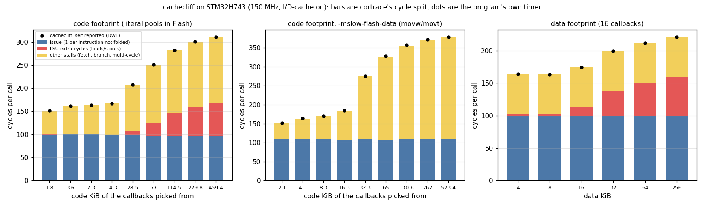

# Cortrace — 用周期剖析交叉验证 cachecliff

日期：2026-10-30
状态：数据来自 STM32H743（Cortex-M7，150 MHz）上的实测。方法和工具见 `08-cycle-profile.md`，其他固件的数据见 `09-profile-measurements.md`。

[cachecliff](https://github.com/FASTSHIFT/cachecliff) 是一个独立的合成负载：随机调用 1024 个生成的回调函数，改变代码足迹、数据足迹，
程序用 DWT 周期计数器给自己计时，打印每次调用的耗时。它回答"悬崖在哪"，不回答"为什么"。
这一篇做两件事：

1. 用 ETM 的周期计数（与程序的计时器是两条独立的路径）核对程序的自报数字。
2. 用 DWT 事件计数器把每个点的周期拆成发射、LSU、其他停顿，说明悬崖是谁造成的。



---
## 1. 实验设置

| 项目 | 内容 |
|---|---|
| 目标 | STM32H743，CPU 150 MHz（HCLK 75 MHz），I-cache 16 KB、D-cache 16 KB（写回），ETMv4 |
| 固件 | cachecliff 的 Cortex-M port（`port/cortex-m`，DWT 周期计数器做计时器）加 `stm32h743-etm-trace-firmware` 的 `make CACHECLIFF=1`，`-O2` |
| 代码 | 1024 个回调在 Flash（459 KiB），走 I-cache |
| 数据 | 256 KiB，在 AXI SRAM（`.axi_bss`），走 D-cache。DTCM 不过缓存，会盖住效果，所以不用 |
| 运行 | 报告打印完后进入"浸泡循环"：每批 20000 次调用，配置从 RAM 里的 `g_cc_soak` 读，调试器用 `mww` 改，固件自己切换缓存（`SCB_Disable*Cache` 会先 clean） |
| 自报 | 固件对每一批用 DWT_CYCCNT 计时，累计在 `g_cc_stat`；抓取前后各读一次，取差 |
| 抓取 | `cortrace arm --os none --profile timing --dwt-events all`，每点 `cortrace profile run --secs 1` |
| 取数 | 回调和调度器 `cc_run` 的自身周期、指令数、DWT 事件加总，除以回调被调用的次数（各 `cc_fNNNN` 的 entries 之和） |

每个点抓一次，共 32 个点、2051 万次调用。SysTick（1 kHz）一直开着，它的处理函数不在回调的统计里，约占 0.1% 的周期，自报里则包含它。

---
## 2. 自报与 trace 对照

32 个点里，trace 的每次调用周期数与程序自报的偏差在 **−0.28% 到 +0.16%** 之间，没有系统偏向。
两边的计时路径互相独立（DWT_CYCCNT 对 ETM 周期计数），所以可以把 cachecliff 的数字当作周期数使用。

DWT 计数器的恒等式在每个点都成立：发射 + LSU + 其他 = trace 的周期，差在 0.1 周期/次以内（表中的最后三列相加）。

### 2.1 代码足迹（数据 4 KiB，缓存全开）

每次调用的周期数。"发射"是没被折叠的指令数，"LSU"是读写的额外周期，"其他"是 CPI 与 EXC 计数器之和（取指、分支、多周期指令）。

| 回调数（代码） | 自报 | trace | 偏差 | 指令 | 发射 | LSU | 其他 |
|---|---|---|---|---|---|---|---|
| 4 个（1.8 KiB） | 150.9 | 150.9 | -0.02% | 142 | 98.4 | 1.8 | 50.8 |
| 8 个（3.6 KiB） | 161.1 | 161.3 | +0.16% | 144 | 99.4 | 1.8 | 60.2 |
| 16 个（7.3 KiB） | 163.6 | 163.7 | +0.03% | 143 | 99.9 | 1.8 | 62.0 |
| 32 个（14.3 KiB） | 167.4 | 167.5 | +0.05% | 139 | 97.4 | 1.7 | 68.4 |
| 64 个（28.5 KiB） | 207.6 | 207.6 | +0.00% | 140 | 97.8 | 8.9 | 100.9 |
| 128 个（57 KiB） | 251.0 | 250.7 | -0.11% | 137 | 96.7 | 29.2 | 124.7 |
| 256 个（114.5 KiB） | 281.9 | 281.8 | -0.02% | 137 | 97.1 | 49.3 | 135.4 |
| 512 个（229.8 KiB） | 300.4 | 300.4 | -0.02% | 138 | 97.3 | 61.9 | 141.2 |
| 1024 个（459.4 KiB） | 311.0 | 310.2 | -0.28% | 138 | 97.4 | 69.3 | 143.6 |

- 拐点在 I-cache 的大小（16 KiB）处。以 cachecliff 报告里的热参考（约 163 周期/次）为准，32 个回调（14.3 KiB）只慢 3%，64 个（28.5 KiB）慢 26%。
- 指令数几乎不变（137 到 144），所以增长全是停顿，不是多做了活。
- 增长里**有一半是 LSU**（1.8 到 69 周期/次）。数据足迹没变，是回调在读自己的常数：见 §3。

### 2.2 数据足迹（16 个回调，缓存全开）

| 数据区 | 自报 | trace | 偏差 | 指令 | 发射 | LSU | 其他 |
|---|---|---|---|---|---|---|---|
| 4 KiB | 163.8 | 163.8 | -0.01% | 143 | 99.8 | 1.8 | 62.2 |
| 8 KiB | 163.5 | 163.6 | +0.11% | 143 | 99.9 | 1.8 | 61.9 |
| 16 KiB | 174.7 | 174.6 | -0.05% | 143 | 99.7 | 13.2 | 61.7 |
| 32 KiB | 199.4 | 199.4 | -0.02% | 143 | 99.8 | 37.9 | 61.8 |
| 64 KiB | 211.8 | 212.1 | +0.13% | 143 | 99.9 | 50.4 | 61.7 |
| 256 KiB | 221.1 | 221.0 | -0.07% | 143 | 99.7 | 59.7 | 61.6 |

增长只出现在 LSU（1.8 到 59.7），发射和其他停顿一动不动。这是"数据足迹扫描只动数据缓存"的直接证据。
拐点在 16 KiB（D-cache 的大小）。

### 2.3 缓存开关

| 配置 | 自报 | trace | 偏差 | 指令 | 发射 | LSU | 其他 |
|---|---|---|---|---|---|---|---|
| 16 个，全开 | 163.8 | 163.6 | -0.12% | 143 | 99.7 | 1.8 | 62.1 |
| 16 个，关 I-cache | 345.3 | 345.3 | +0.01% | 143 | 102.2 | 1.8 | 241.4 |
| 16 个，关 D-cache | 416.1 | 415.8 | -0.07% | 143 | 99.6 | 255.7 | 60.4 |
| 16 个，全关 | 643.6 | 643.0 | -0.11% | 142 | 99.6 | 361.9 | 181.3 |
| 1024 个，全开 | 311.2 | 311.4 | +0.08% | 139 | 97.8 | 69.6 | 144.1 |
| 1024 个，关 I-cache | 425.7 | 425.2 | -0.12% | 138 | 98.0 | 81.6 | 245.6 |
| 1024 个，关 D-cache | 526.5 | 526.5 | -0.00% | 138 | 96.4 | 327.3 | 102.7 |
| 1024 个，全关 | 666.8 | 666.4 | -0.07% | 139 | 96.8 | 362.2 | 207.2 |

- 关 I-cache 加的是"其他"（取指停顿，62 到 241），LSU 不动；关 D-cache 加的是 LSU（1.8 到 256），"其他"不动。两个缓存各管各的计数器。
- 16 个回调的热循环里，关 D-cache 就慢 2.5 倍，而数据区只有 4 KiB：慢在回调的常数（§3）和数据都要走总线。
- 缓存全开时 1024 个回调的代码足迹代价是 1.9 倍（311 对 164）；缓存全关时，16 个和 1024 个回调只差 4%（643 对 667），因为已经没有缓存可丢。

---
## 3. 代码足迹里的数据缓存：字面量池

§2.1 里代码足迹增大时 LSU 也涨，而数据区没变。看反汇编：回调里有大量 `ldr rX, [pc, #imm]`，
把 32 位常数从函数后面的字面量池读出来。字面量池在 Flash 里，这些是**数据读**，经 D-cache。
回调很多时，这些池占的 D-cache 行也装不下，LSU 就涨了。

验证：用 `-mslow-flash-data` 重编（常数改由 `movw`/`movt` 在指令里给出），其余不变，重新扫描。

| 回调数（代码） | 自报 | trace | 偏差 | 指令 | 发射 | LSU | 其他 |
|---|---|---|---|---|---|---|---|
| 4 个（2.1 KiB） | 152.3 | 152.0 | -0.17% | 168 | 109.1 | 0.0 | 42.9 |
| 8 个（4.1 KiB） | 163.6 | 163.4 | -0.13% | 169 | 110.3 | 0.0 | 53.1 |
| 16 个（8.3 KiB） | 169.4 | 169.4 | +0.03% | 169 | 110.7 | 0.0 | 58.7 |
| 32 个（16.3 KiB） | 183.8 | 183.8 | +0.01% | 166 | 108.1 | 0.0 | 75.6 |
| 64 个（32.3 KiB） | 275.1 | 275.5 | +0.16% | 167 | 109.3 | 0.0 | 166.2 |
| 128 个（65 KiB） | 327.6 | 326.7 | -0.27% | 163 | 108.2 | 0.1 | 218.4 |
| 256 个（130.6 KiB） | 356.6 | 355.8 | -0.21% | 164 | 109.0 | 0.1 | 246.7 |
| 512 个（262 KiB） | 371.6 | 371.2 | -0.12% | 165 | 109.9 | 0.1 | 261.2 |
| 1024 个（523.4 KiB） | 378.8 | 378.8 | +0.00% | 165 | 110.3 | 0.1 | 268.4 |

LSU 全程为 0，增长全在"其他"（取指停顿）：悬崖变成纯 I-cache 的，拐点在 16.3 KiB 之后，终点是 2.5 倍（379 对 152）。
cachecliff 单看自己的数字，只能看到悬崖变陡了；trace 说明变陡的原因是 D-cache 的那一份没了，取指的那一份没变。

这不是 cachecliff 的缺陷：编译出来的 Cortex-M 代码就会从代码段读常数，真实程序也一样。但要把 I-cache 单独量出来，
应当用 `-mslow-flash-data`，或者把回调放进 ITCM/RAM。

---
## 4. 依赖读（指针追逐）

cachecliff 用一条随机环链测每次依赖读的延迟。固件的 `mode 1` 只跑这个。循环是 5 条指令（`adds`、`lsls`、`cmp`、`ldr`、`bne`）。
trace 一侧用函数的周期数除以（指令数 / 5）。

| 数据区 | 自报（周期/次） | trace（周期/次） | trace 的 LSU（周期/次） |
|---|---|---|---|
| 4 KiB | 3.000 | 3.001 | 0.00 |
| 8 KiB | 3.000 | 3.002 | 0.00 |
| 16 KiB | 3.001 | 3.005 | 0.00 |
| 32 KiB | 10.292 | 10.306 | 7.28 |
| 64 KiB | 11.855 | 11.917 | 8.86 |
| 128 KiB | 11.997 | 12.131 | 9.02 |
| 256 KiB | 12.002 | 12.296 | 9.09 |

- 16 KiB 以内是 3 周期（D-cache 命中，20 ns），32 KiB 起是 10 到 12 周期（AXI SRAM，约 80 ns）。多出来的周期全部在 LSU 计数器里
  （12.0 − 3.0 ≈ 9.1）。
- trace 一侧在大区域上偏高（256 KiB 高 2.4%）：函数的周期里还有每次测量前建环链的开销（4096 个节点，每个有一次取模），除以的是循环次数，所以越大越偏（这是推断，没有单独量建链的时间）。
- **缓存全关时两边不一致**：自报 26.02 周期，函数平均给出 25.05（−3.7%）。函数里最热的两个基本块（4.15M 次和 1.42M 次，各自占一个迭代）
  的平均是 26.00 周期，与自报一致。恒等式在这个抓取里成立（+0.00%），所以指令数和周期数本身没问题；两种取法差在哪，我没有查清。
  关缓存的依赖读以块的数字为准，函数平均只作参考。

---
## 5. 局限

- 每个点只抓了一次，没有重复。32 个点的偏差分布（−0.28% 到 +0.16%）说明单次抓取的噪声在这个量级。
- 自报和 trace 同时在测，trace 一直开着。没有单独量"关 trace"对自报的影响；启动时（未布防）的累计平均 310.9 周期/次，布防后 311.0，没有看出差别。
- 回调数是 trace 里各回调的进入次数之和，调度器（`cc_run`，约占 9%）的周期算进每次调用里，自报同样包含它。
- 事件包每 256 个事件一个，按函数归属有误差；这里把回调和调度器合起来加总，归属误差抵消。
- §4 的 `cc_chase` 被编译器内联进了测量函数，所以不能直接取这个函数的周期，只能用指令数反推循环次数。
- 这些是这块板、这个链接配置、`-O2` 下的数字。

---
## 6. 复现

```sh
# 固件（cachecliff 克隆在固件仓库旁边）
make -C stm32h743-etm-trace-firmware GCC_PATH=/usr/bin CACHECLIFF=1
# 加 EXTRA_CFLAGS=-mslow-flash-data BUILD_DIR=build-cachecliff-sfd 得到 §3 的版本
bash cortrace-fpga/host/scripts/nxtrace_flash.sh stm32h743-etm-trace-firmware/build-cachecliff/H743_Blink.hex

# 常驻 OpenOCD（不用 4444 就换端口），布防
openocd -f interface/cmsis-dap.cfg -f target/stm32h7x.cfg -c init &
cortrace arm --platform stm32h743 --os none --profile timing --dwt-events all --probe-telnet 127.0.0.1:4444
```

改配置：`g_cc_soak` 是 7 个连续的 32 位字，依次是 `nfuncs skew period data_bytes batch caches mode`，
地址取自符号表，用 OpenOCD 的 `mww` 逐个写（固件在下一批开始时读到）：

```sh
arm-none-eabi-nm fw.elf | grep -E 'g_cc_(soak|stat)'
# 64 个回调，数据 4 KiB，一批 20000 次，缓存全开，回调模式
#   mww <g_cc_soak+0> 64      mww <g_cc_soak+4> 1       mww <g_cc_soak+8> 0
#   mww <g_cc_soak+12> 4096   mww <g_cc_soak+16> 20000  mww <g_cc_soak+20> 3   mww <g_cc_soak+24> 0
```

自报在 `g_cc_stat`（`batches calls_lo ticks_lo last_ticks last_calls sink chase_x1000`），抓取前后各读一次，取 `ticks_lo` 与 `calls_lo` 的差之比。
抓取与剖析：

```sh
cortrace profile run --elf fw.elf --out-dir out --iface <nic> --secs 1 --sysclk-hz 150e6 --tsgen-hz 75e6
```

然后把 `prof_*.json` 里 `cc_run` 和所有 `cc_f*` 函数的 `cycles`、`instructions`、`events` 加总，除以 `cc_f*` 的 `entries` 之和。
